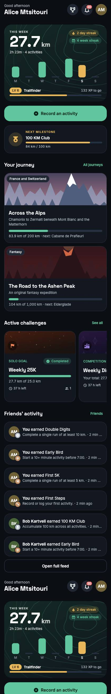
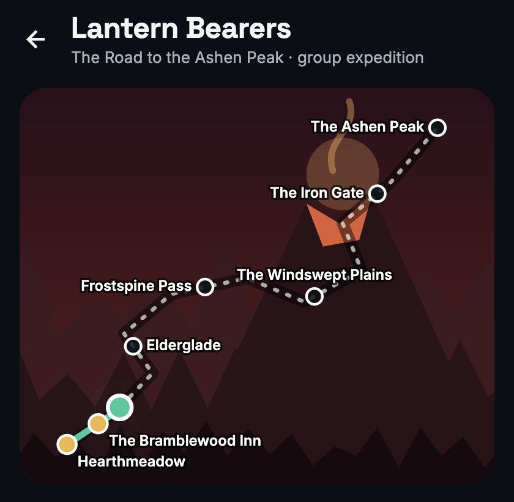
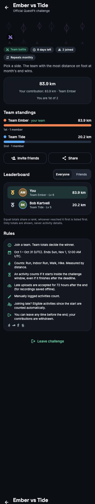
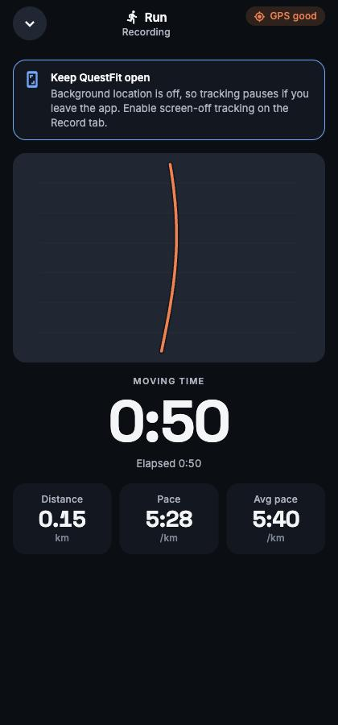

# QuestFit

QuestFit is a cross-platform (iOS, Android, web) fitness tracker that turns workouts into an
adventure. Record GPS runs, rides, walks and hikes or log anything manually; join solo goals,
head-to-head duels, team battles and community challenges; travel original epic journeys with your
real kilometres; unlock themes, levels and achievements; and share it all with friends.

| Home | Journey map | Team challenge | Live recorder |
| --- | --- | --- | --- |
|  |  |  |  |

## Highlights

- **Server-authoritative game engine.** Progress, rankings, XP, achievements, streaks and unlocks
  are computed in PostgreSQL in the same transaction as the activity write. The app is treated as
  an untrusted client; RLS and SECURITY DEFINER RPCs block every direct write to protected data.
- **Reliable recording.** Timestamp-based timing, GPS filtering (accuracy, jitter, jumps,
  segments), background tracking via a foreground service / iOS background mode, crash and
  interruption recovery, and a durable upload queue with idempotent submissions.
- **Challenges** in four modes, three metrics, weekly/monthly/yearly/custom windows and recurring
  series, with late-upload grace, retroactive joins, leave semantics and consistent tie handling.
- **Epic journeys** with configurable checkpoints, story text, rewards, solo or group parties and
  replay. All artwork is original and procedurally drawn.
- **Themes** unlocked by thresholds stored in the database, validated and contrast-checked to
  WCAG AA before they are applied.
- **Social**: friends, profiles with privacy levels, blocking, a feed with kudos and comments,
  in-app notifications (push is optional), invitations and leaderboards.

## Quick start

Requirements: Node.js 20.19+, Docker Desktop.

```bash
npm install
npm run db:start            # local Supabase (Postgres, Auth, Storage, Mailpit)
npm run db:reset            # migrations + demo data
cp .env.example .env.local  # fill in the URL and anon key printed by `npx supabase status`
npx expo start              # w = web, or open on a device with a development build
```

Sign in with `alice@questfit.dev` / `questfit-dev-1` (demo data, local only), or create an account;
confirmation codes arrive in Mailpit at <http://127.0.0.1:54324>.

Full instructions, including hosted Supabase, auth providers, push and native builds, are in
[docs/SETUP.md](docs/SETUP.md).

## Scripts

| Command | Purpose |
| --- | --- |
| `npm run typecheck` | TypeScript (strict) |
| `npm run lint` | ESLint with React Compiler rules |
| `npm test` | Jest: domain logic, GPS filter, recording state machine, outbox, theme contrast, components |
| `npm run test:db` | Database engine, RLS and rule-parity tests on PGlite (no Docker) |
| `npm run test:db:integration` | Concurrency tests against the local Supabase Postgres |
| `npm run test:all` | Typecheck, lint, Jest and database tests (everything except the Docker-based integration suite) |
| `npm run db:types` | Regenerate `src/types/database.ts` |
| `npm run export:check` | Bundle for iOS, Android and web |

## Project structure

```
src/app/            Expo Router screens: (auth), onboarding, (app)/(tabs) and stack screens
src/features/       Data hooks and components per feature (activities, challenges, journeys, …)
src/domain/         Pure business logic (units, GPS filter, recording, progress, ranking, periods)
src/components/     Design system and brand art
src/theme/          Tokens, palettes, contrast enforcement, theme provider
src/lib/            Supabase client, secure session storage, errors, formatting
supabase/migrations Schema, engine, RPCs, RLS, storage, production content
supabase/seed.sql   Local demo data only
supabase/tests      Database tests (PGlite); supabase/integration: real-Postgres concurrency
supabase/functions  Optional push-dispatch Edge Function
docs/               Setup, architecture and requirement checklist
```

## Documentation

- [docs/SETUP.md](docs/SETUP.md): local development, hosted Supabase, environment variables,
  iOS and Android builds, push notifications, scheduled jobs.
- [docs/ARCHITECTURE.md](docs/ARCHITECTURE.md): architecture, engine rules, consistency
  strategy, security and threat model, privacy and location safety.
- [docs/CHECKLIST.md](docs/CHECKLIST.md): every requirement with its verification status.

## Known limitations

- Native-only behaviour (background GPS, native maps, push, Apple/Google sign-in, secure storage
  on device) is implemented and bundles for iOS and Android but has not been verified on physical
  devices in this repository's test runs.
- GPS spoofing cannot be detected without device attestation; plausibility limits catch
  impossible activities, not well-crafted fakes. Challenges can disallow manual entries.
- There is no automated device E2E suite yet; user flows were verified against the web build.

## License

No license has been chosen yet. All rights reserved until one is added.
